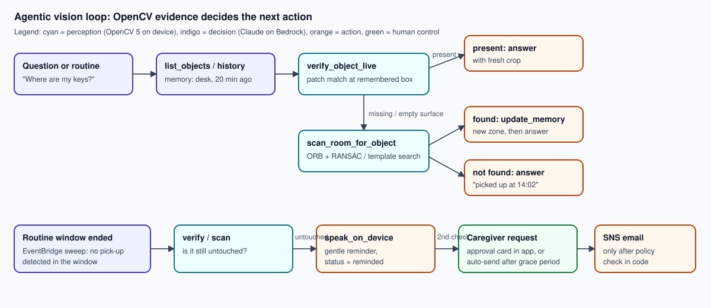

# iCamFind: technical report

OpenCV AI Competition 2026, powered by AWS. Paths: overall prizes and the Agentic Vision Award.

## 1. Problem and users

People living with dementia, mild cognitive impairment or ADHD lose track of everyday objects many
times a day: keys, glasses, wallets, phones, medication. Each search costs time and confidence, and
for carers it means constant interruptions. Bluetooth trackers cover only the few items that carry
a tag. Cloud cameras record video, but you can't ask them anything.

**Primary user:** the person who misplaces things. They ask in plain words, by voice or text, and
get a short answer with a photo and a time.
**Secondary user:** a family member or care worker. They set routines such as evening medication,
approve notifications, and review what happened.

**Design goals:** answers must be *current* (checked against the live scene, not only recalled);
the system must work locally when the internet is down; privacy must be protected by default; and
any action that reaches another person must stay under human control.

## 2. System overview

| Layer | Runs on | Responsibilities |
|---|---|---|
| Edge perception | Laptop/mini-PC with a webcam or RTSP CCTV | OpenCV 5 scene memory, people masking, re-ID, live verify/scan, door alert, local journal |
| Cloud memory | DynamoDB, S3 (+ Glacier IR) | Object state, full event history, crops, agent traces, routines, approvals |
| Cloud reasoning | Lambda + Amazon Bedrock (Claude Haiku 4.5, `au.` profile) | Open-vocabulary naming of crops; the perception-decision-action agent |
| Delivery | API Gateway HTTP API, EventBridge, SNS, CloudWatch/X-Ray | Web app + API, routine sweeps, caregiver email, logs/traces/alarms |

Everything in the cloud is one SAM/CloudFormation stack (`cloud/template.yaml`), deployed by
`scripts/deploy.py` with the AWS CLI alone.

## 3. OpenCV 5 implementation (edge)

All perception code is in `icamfind/edge/`. It runs on CPU at 10-12 fps with 640 px frames. The
scene logic takes 23-38 ms per frame (median), and the DNN runs in a background thread at about
2.5 Hz.

### 3.1 Dual-background static-change detection (`scene.py`)
- **Short-term model:** `cv.createBackgroundSubtractorMOG2(history=40)` on a Gaussian-smoothed
  frame. Anything that stops moving is absorbed within a fraction of a second, so its foreground,
  after opening and dilation, means "moving right now".
- **Long-term memory:** our own float32 reference background. It changes only through slow
  selective drift (`cv.accumulateWeighted`, α=0.002, masked to quiet pixels) and through explicit
  absorption after an event is committed. Its foreground means "different from memory".
- **Evidence accumulator:** a per-pixel float that adds `dt` where the pixel differs from memory,
  isn't moving and isn't covered by a person. It decays by `2·dt` once the pixel matches memory
  again. Because it counts time rather than frames, results don't depend on frame rate.
- **Region grouping:** evidence above 0.25 s is closed with a 15×15 ellipse and split into
  connected components (`cv.connectedComponentsWithStats`). A region is committed only when at
  least 85% of its evidence pixels have been stable for `stable_seconds` (2 s), there's no motion
  within 12 px, and no person box nearby. That gives one event per object, timed after the hand
  has left.
- **Lighting guard:** if more than 35% of the frame differs from memory without matching motion
  for more than 1 s (lights switched on, auto-exposure jump), the long-term model re-baselines
  instead of reporting events.

### 3.2 Explaining a change
- **Pick-up:** for each remembered object overlapping the region, the current patch is compared
  with two references: the object's appearance, and the surface that was underneath it. The
  comparison is 0.6·NCC + 0.4·(1 − mean absolute difference). If the patch matches the empty
  surface better, the object was **removed**.
- **Placed vs. taken (ghost test):** for a new region, we compare the mean Sobel gradient magnitude
  along the region boundary in the current frame with the same boundary in the remembered
  background. If the edges belong to the current frame, something was **placed**. If they belong
  to the old background, an object that was already there when memory started was **taken away**.
  It is then labelled from the background patch.
- **Moved (re-identification, `appearance.py`):** a newly placed object is compared with objects
  removed in the last 12 hours using a fused similarity: 0.5·HSV hue-saturation histogram
  correlation, 0.35·ORB match ratio (Hamming brute-force with Lowe's ratio test), and 0.15·aspect
  similarity. Above 0.6 it keeps the old identity and produces one **moved** event, for example
  "desk → shelf".

### 3.3 DNN (`detector.py`)
YOLOX-S from the OpenCV Model Zoo (`object_detection_yolox_2022nov.onnx`, SHA-256 pinned) runs on
`cv.dnn.readNet`, with our own letterbox, grid decoding and `cv.dnn.NMSBoxesBatched`. It has two
jobs:
1. **People:** person boxes are dilated and masked out of the evidence, so a person standing still
   never becomes an "object". The same boxes are pixelated in every outgoing image.
2. **Label hint:** the best COCO label for a new region, from full-frame detections or a zoomed
   context crop for small items. Furniture classes are ignored.

The cloud then replaces generic labels with open-vocabulary names (§4.1).

### 3.4 Geometry and live tools
- **Zones:** user-drawn polygons tested with `cv.pointPolygonTest` at the object's bottom-centre,
  since objects rest on surfaces.
- **Room map:** `cv.getPerspectiveTransform` from four floor points gives top-down coordinates.
- **`verify`:** patch match at the remembered box against both the appearance and the empty-surface
  references.
- **`scan`:** ORB keypoints with `cv.findHomography(RANSAC)` handle rotation and scale. If that
  fails, multi-scale `cv.matchTemplate(TM_CCOEFF_NORMED)` runs instead. Person regions are masked
  out of the search.

### 3.5 Local-first behaviour
Every event is appended to `data/journal.jsonl` with its crop before any network call. A retry
queue with exponential backoff syncs it. Object state (appearance, underlying surface, mask)
persists in `data/objects/`, so memory survives restarts. Without cloud settings the device runs
local-only, still remembering and still giving door alerts through text-to-speech.

### 3.6 The same pipeline in the browser (OpenCV 5.0 WebAssembly)

`cloud/src/web/edge.js` ports the scene memory, re-identification, verify/scan and uplink to
**OpenCV 5.0.0 compiled to WebAssembly** (`@techstark/opencv-js@5.0.0-release.1`, pinned with
Subresource Integrity), so any laptop, tablet or phone running the web app can be the camera.
There is no install: the user clicks **Use this computer's camera** and draws their places on the
live picture. Video frames are processed inside the browser tab and never uploaded.

Two adaptations for the browser:
1. No person detector runs there. Evidence is restricted to the places the user drew, so a person
   sitting in front of a laptop is never remembered as an object, and the largest allowed object
   is 12% of the frame.
2. The door alert triggers on sustained motion inside the door area.

The module's scene-memory core is DOM-free, so `scripts/web_engine_bench.js` replays the
synthetic benchmark through it in Node and scores it with the same Python scorer (results in §5).

## 4. AWS deployment

### 4.1 Services and why

| Service | Use |
|---|---|
| API Gateway HTTP API | One endpoint for the device, the web app and judges. Route throttling at 20 rps with a burst of 40 |
| Lambda (Python 3.12, **arm64/Graviton**) | `api` (ingest, state, approvals, serving the web app), `agent` (240 s, 1 GB), `scheduler` |
| DynamoDB (on-demand, single table + `gsi1`) | Objects, event history (newest first per object and globally), commands, jobs + steps, routines, alerts, approvals. TTL on transient items, point-in-time recovery, encryption at rest |
| S3 | Crops, snapshots, live-check images. Public access blocked, SSE, TLS-only bucket policy. **Lifecycle:** crops move to Glacier IR after 30 days and are kept indefinitely (unbounded memory); snapshots and check images expire |
| Amazon Bedrock | **Claude Haiku 4.5 via the `au.` geographic inference profile**, so processing stays in Australia. Used for crop naming and the agent. Client-side fallback to Sonnet 4.6 (`au.`) on access errors or refusals. Models are configurable by stack parameter |
| EventBridge | `rate(5 minutes)` routine sweep |
| SNS (KMS) | Caregiver email, sent only after approval or escalation |
| CloudWatch / X-Ray | JSON logs with 30-day retention, API access logs, active tracing, an alarm on agent errors |
| Amazon Cognito | Sign-up/sign-in (hosted UI, PKCE) and JWT authorizer on the HTTP API |
| EC2 (t4g.small, Graviton) + Secrets Manager + SSM | The **Demo home replay camera**: the unmodified edge pipeline replays a recorded room 24/7, so judges can test live verification without hardware. It has no inbound ports and is managed through SSM Session Manager |

**Open-vocabulary naming:** COCO has no "keys" or "pill bottle" class. When an object is first seen,
the `api` Lambda sends its privacy-filtered crop to Claude, which returns
`{label, description, essential}`. In the live test it produced names like "leather wallet" and
"roll of tape". If naming fails, the event is still stored with the local label.

### 4.2 Agent (Agentic Vision path)

`cloud/src/agent.py` runs a manual tool-use loop of up to 10 turns. Its tools:

| Tool | What it does | Where the evidence comes from |
|---|---|---|
| `list_objects`, `get_object_history` | Read memory | DynamoDB, written from OpenCV events |
| `verify_object_live` | Device patch-matches the remembered box and returns `present`, scores and a fresh crop | Edge OpenCV, through a DynamoDB command queue the device polls every 1.5 s |
| `scan_room_for_object` | Device searches the whole frame (ORB+RANSAC / template matching) and returns zone, confidence and an image | Edge OpenCV |
| `update_object_status` | Corrects memory when live evidence disagrees, writing a `corrected` event | DynamoDB |
| `speak_on_device` | Text-to-speech reminder on the home device | Edge |
| `request_caregiver_notification` | Code-level policy: creates an **approval card** in the app, or sends directly only if a spoken routine reminder went unanswered past the grace period (default 10 min). At most once per day | SNS |
| `record_routine_status`, `final_answer` | Bookkeeping and the answer, including which object to show | |

The device's crops are returned to the model as **image blocks** inside tool results, so the model
sees what the camera saw. The visual result decides the next step:
- present → answer with the fresh crop;
- empty surface → scan the room;
- found elsewhere → update memory, then answer;
- not found → answer with the last known pick-up time;
- routine untouched → remind; still untouched later → ask for caregiver approval.

Every step (model text, tool input, tool output, image) is stored as a job step and shown live in
the app. That is the observability and trace evidence the award asks for.

**Traces recorded against the deployed stack** (`docs/evidence/`, replaying a synthetic clip as the
camera):
- *"Where is my leather wallet?"* → list_objects → verify_object_live (match 0.91, present) →
  answer. 10 s.
- *"I can't find the roll of tape"* → memory says picked up → scan_room_for_object (found on desk,
  0.99) → update_object_status → answer. 12 s.
- *Routine "Evening medication"*, three consecutive checks:
  1. after a pick-up inside the window → `ok`;
  2. untouched → verify → scan → `speak_on_device` → `reminded`;
  3. still untouched → `request_caregiver_notification`, which returned `pending` because the grace
     period had not elapsed → `escalated`, with an approval card in the app.

### 4.3 Security and reproducibility
- **People:** Amazon Cognito user pool with email verification and the hosted UI (authorization
  code + PKCE; tokens last 60 min, refresh tokens 30 days). The API Gateway JWT authorizer
  verifies every `/api/*` request before the Lambda runs.
- **Tenancy:** each account owns a private household. All DynamoDB keys are prefixed with the
  household id, S3 images live under a per-household prefix, and globally addressed items (jobs,
  commands, approvals, routines) are checked on read. Selecting a home the user doesn't belong to
  returns 403.
- **Cameras:** each camera has its own random device token, shown once and stored only as a
  SHA-256 hash. The demo replay camera's token sits in AWS Secrets Manager and is read by the EC2
  instance role.
- **IAM:** least privilege through SAM policy templates per function, plus Bedrock invoke actions.
- **Web app hardening:**
  - security headers: `nosniff`, `DENY` framing, no referrer, and a permissions policy that allows
    the camera and microphone only for this origin;
  - CSP: scripts only from this origin and the pinned jsDelivr OpenCV build, loaded with
    Subresource Integrity. `'wasm-unsafe-eval'` and `'unsafe-eval'` are allowed because OpenCV.js
    (WebAssembly + embind) needs them;
  - all server strings are escaped in the UI.
- **Reproducible deploy:** pinned Python dependencies (`requirements*.txt`), the model checksum in
  `scripts/get_models.py`, and a one-command deploy. The Lambda package is pure Python with no
  bundled wheels.

## 5. Evaluation

### 5.1 Reproducible synthetic benchmark
`python -m icamfind benchmark --no-dnn` renders 5 seeded clips (150 s each, 15 fps). Each clip
includes:
- sensor noise and slow lighting drift;
- a sudden 25% lights-on jump;
- a hand-and-arm occluder that travels in, dwells and leaves for every action;
- distractor waving, which should produce no events;
- one pre-existing object taken away;
- objects carried between zones.

Ground truth is the time the hand leaves. A detection matches if it reports the same type between
0.5 s early and 6 s late.

| Metric | Result |
|---|---|
| Ground-truth events | 65 (30 placed, 25 removed, 10 moved) |
| Precision / Recall / F1 | **0.970 / 0.985 / 0.977** |
| Zone accuracy (matched events) | **1.00** |
| Exact type accuracy (moved reported as moved) | **1.00** (10/10 moves) |
| Identity kept across an object's events | **20/20** objects |
| Mean latency after the hand leaves | **1.47 s** (the stability window is 2 s, measured from when the object became static) |
| Lighting jumps | each clip's lights-on jump triggered exactly one re-baseline |
| Scene-logic cost | 23-38 ms per frame median, laptop CPU |

Full per-clip table and failure list: [EVALUATION.md](EVALUATION.md).

**Ablation** ([ABLATION.md](ABLATION.md), same 5 clips):

| Variant | F1 | Identity kept |
|---|---|---|
| Full pipeline | 0.977 | 20/20 |
| Short stability window (0.4 s) | 0.683 (102 predictions for 65 events) | 17/20 |
| No ghost test | 0.916 | 20/20 |
| No re-identification | 0.916 | 10/20 |
| No lighting guard | 0.977 | 20/20 |

- **Stability window:** waiting for the hand to leave matters most. Committing too early records
  hands and half-placed objects.
- **Ghost test:** without it, every pre-existing object that is taken away shows up as a phantom
  "placed".
- **Re-identification:** without it, half of the identities break.
- **Lighting guard:** no measurable effect on this benchmark. The full-frame lights jump is already
  absorbed by the large-region rule (any region over 25% of the frame is treated as scene change).
  The guard is meant for partial lighting changes, which this benchmark does not test.

**Browser engine parity:** `edge.js` (OpenCV.js 5.0.0, WebAssembly), replayed in Node on the same
5 clips with `placesOnly` off, gives **identical** results to the Python pipeline:
- F1 1.0 / 0.923 / 1.0 / 1.0 / 0.966 per clip;
- the same failure events;
- identity kept 20/20;
- 27-52 ms per frame median in Node (the higher figures were measured while other test suites ran).

In a real browser (headless Edge with the benchmark room as a fake webcam, against the deployed
cloud):
- OpenCV.js loaded in 3.2 s and ran at about 7.5 fps;
- place, remove and move events were uploaded and named by Claude.

### 5.2 Failure cases observed
- **Seed 2:** the pre-existing object's removal was reported as "placed" (one miss, one false
  positive). The ghost test made the wrong call. Our *likely* explanation, not yet confirmed:
  boundary gradients were similar in the old and new frames, and ties default to "placed".
- **Seed 5:** one spurious "removed" on the side table at t=77.5 s. Its root cause is still being
  investigated.

### 5.3 Real footage
`python -m icamfind record`, `annotate` and `eval` capture a clip, label it and score it in the
same format (see README). Real-footage results are reported in the video. We expect lower scores
than on the synthetic benchmark, for the reasons in §6.

### 5.4 System tests
- **Live cloud suite** (`scripts/cloud_e2e.py`, 49 checks, all passing against the deployed stack):
  - anonymous, forged-JWT and bad device-token requests are rejected;
  - one home cannot read another's objects (404) or select it (403);
  - the demo camera is online and answers live checks;
  - a test camera's event is named by Claude ("house key") and flagged essential;
  - the agent verifies present keys live, and escalates to a room scan once the camera reports the
    desk empty;
  - routines go to a spoken reminder, then a caregiver approval, and an approval cannot be reused;
  - pairing codes work, are single-use, and tolerate case and dashes.
- **Web app suite** (`tests/ui/e2e.py`): Playwright with headless Microsoft Edge, a fake webcam
  replaying the benchmark room, and a mocked backend implementing `docs/API.md`. It covers sign-in
  (PKCE), tab navigation, the camera wizard and place drawing, engine events, asking with the "Here
  it is" picture, the demo home, Things, Routines and approvals, pairing, reload and resume,
  sign-out, accessibility names and the 390 px mobile layout.
  - It found and fixed 11 UI issues.
  - One of them was critical: production CSP blocked OpenCV.js, whose embind needs
    `'unsafe-eval'`. After the fix, OpenCV 5.0.0 loads on the live site in about 1.3 s.

### 5.5 Agent evaluation
End-to-end task success is visible in the traces. On the deployed stack with Haiku 4.5:
- **Locate questions:** 4/4 correct (2 on Opus 4.6 during development, 2 on Haiku 4.5), 7-13 s
  end to end.
- **Routine flows:** 3/3 checks reached the expected state (ok, then reminded, then escalated
  pending approval). One earlier run misread the routine window as "not started"; we fixed it by
  stating the window state explicitly in the prompt.
- **Failure handling:**
  - camera offline → the tools return `camera offline` and the agent answers from memory with the
    last-seen time;
  - camera too slow → a 25 s timeout;
  - stale commands expire after 120 s;
  - tool exceptions go back to the model as `is_error` results;
  - model unavailable or refusing → the request is retried on the fallback model.

## 6. Limitations
- **Single camera, line of sight:** objects hidden inside drawers, bags or behind other objects
  can't be seen. The agent then says when the object was last seen and where it was picked up.
- **Small, transparent or very dark objects:** below about 0.12% of the frame (roughly 20×20 px at
  640×480), or with very low contrast against the surface, they may be missed. Glass is
  particularly hard.
- **Objects carried in a hand** aren't tracked through the room. Only put-down and pick-up are seen.
- **Re-ID can fail** for near-identical objects (two similar black wallets) or under large pose
  change.
- **Big rearrangements** (furniture moved, camera bumped) are deliberately absorbed rather than
  reported.
- The **synthetic benchmark** is a controlled test of the logic, not proof of real-world accuracy.

## 7. Responsible use
- **Privacy by design:**
  - only object crops, privacy-filtered snapshots and live-check crops leave the device, never
    video;
  - people are pixelated before upload;
  - processing on Bedrock stays in Australia (`au.` profile), and Bedrock does not store prompts
    or outputs and does not train on them;
  - images tier to cold storage, and transient images expire.
- **Consent:** install only in spaces where everyone has agreed to it. Don't point the camera at
  bathrooms or bedrooms. The camera's field of view is visible on the device preview and in the app.
- **Human control:** the model can't contact anyone by itself. Caregiver email needs human approval
  or an unanswered reminder, enforced in code, and every action is logged with its evidence.
- **Not a medical device:** routines are memory aids, not medication management or safety
  monitoring. Answers state their uncertainty and last-seen times.
- **Honest claims:** the benchmark is synthetic and labelled as such. Live traces come from the
  deployed system.
